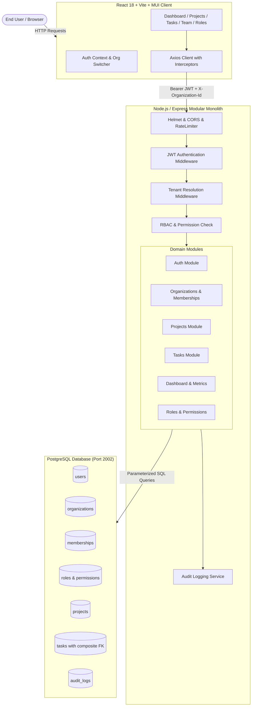

# System Architecture

## Overview

The **Multi-Tenant SaaS Project Management Platform** is architected as a modular monolith adhering to strict separation of concerns, enterprise-grade multi-tenant data isolation, and defense-in-depth principles.

---

## Request Lifecycle & Security Pipeline

Every HTTP request accessing tenant-scoped resources traverses an explicit 10-stage pipeline:

1. **HTTP Security Headers (`helmet`)**: Disables DNS prefetching, enforces X-Frame-Options (DENY), XSS protections, and strict MIME-type sniffing prevention.
2. **CORS Validation**: Strictly enforces allowed origins from `CLIENT_URL` with credentials support.
3. **API Rate Limiting (`express-rate-limit`)**: Prevents denial-of-service and brute-force credential stuffing.
4. **Request Body / Parameter Validation (`Zod`)**: Validates shapes, UUID formats, lengths, and enums before reaching controllers.
5. **JWT Authentication Middleware (`authenticate`)**:
   - Decodes and verifies signed JWT signature and expiration.
   - Verifies the user exists in PostgreSQL.
   - Populates `req.user = { id, name, email }`.
6. **Tenant Context Resolution Middleware (`resolveTenant`)**:
   - Extracts target organization identifier from route param (`:organizationId`) or header (`X-Organization-Id`).
   - Queries `memberships` table in PostgreSQL to verify that `req.user.id` has an **active** membership.
   - Rejects suspended or non-member users with `403 Forbidden`.
   - Populates trusted `req.tenant = { organizationId, roleName, permissions: Set }`.
7. **Role-Based Authorization Middleware (`requirePermission`)**:
   - Verifies that `req.tenant.permissions` contains the required permission key (e.g. `project:delete`, `task:assign`).
8. **Controller Layer**:
   - Extracts validated parameters and hands off to the service layer.
9. **Service Layer**:
   - Executes domain business logic, enforces business invariants (such as preventing demotion of the sole active admin), and manages transactions.
10. **Repository & Data Access Layer (`pg.Pool`)**:
    - Executes parameterized SQL queries strictly filtered by `WHERE organization_id = $x`.
    - Never concatenates user input into SQL.
