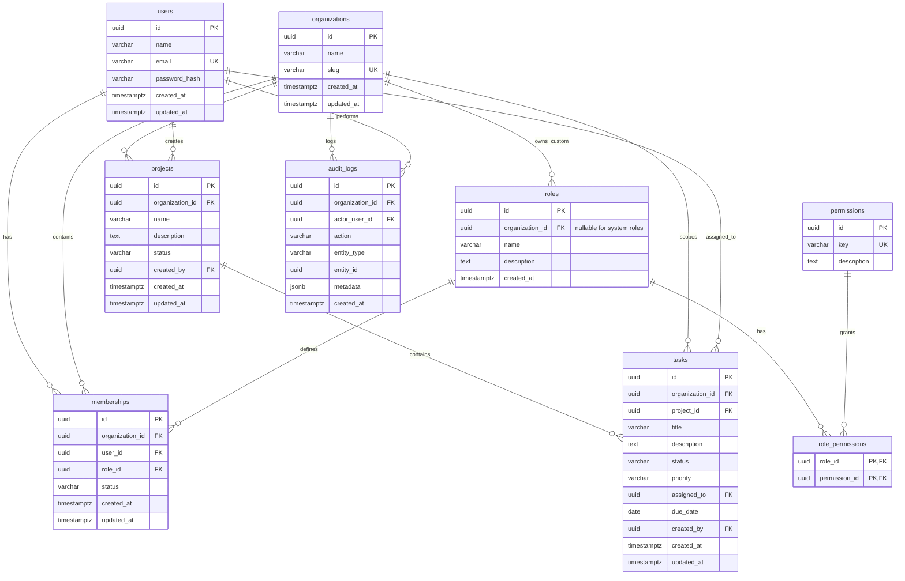

# Database Schema & Data Modeling

## Entity Relationship (ER) Diagram



---

## Relational Integrity & Architectural Highlights

### 1. Composite Foreign Keys for Tenant Consistency
A common pitfall in multi-tenant systems is allowing a child resource (like a `task`) to reference a parent resource (like a `project`) belonging to an entirely different tenant.

To prevent this at the database engine level, the `projects` table defines a composite unique constraint:
```sql
CONSTRAINT uq_projects_id_org UNIQUE (id, organization_id)
```
And the `tasks` table defines a composite foreign key constraint:
```sql
CONSTRAINT fk_tasks_project_org 
FOREIGN KEY (project_id, organization_id) 
REFERENCES projects(id, organization_id) 
ON DELETE CASCADE
```
**Guarantee**: Even if application-level validation were somehow bypassed, PostgreSQL will reject any attempt to insert a task whose `organization_id` does not match the project's `organization_id`.

### 2. System Roles vs. Tenant-Scoped Custom Roles
The `roles` table uses a nullable `organization_id`:
- When `organization_id IS NULL`, the role is a global system default (`Admin`, `Manager`, `Member`). A partial unique index `idx_roles_system_name` enforces unique names across system roles.
- When `organization_id IS NOT NULL`, the role is a custom role created by a specific tenant. A composite unique index `idx_roles_org_name` prevents duplicate role names within that organization.

### 3. Automatic Timestamps via Triggers
Every mutable table (`users`, `organizations`, `memberships`, `projects`, `tasks`) includes an `updated_at` trigger calling `update_updated_at_column()` to guarantee reliable auditability.

### 4. Indexing Strategy
- `idx_users_email`: B-tree index on normalized lowercase email for O(log N) login lookups.
- `idx_memberships_org_user`: Composite index for rapid tenant context verification.
- `idx_projects_org` & `idx_projects_org_status`: Supports instant paginated project queries filtered by tenant and status.
- `idx_tasks_org_status_priority` & `idx_tasks_org_assigned`: Optimized for dashboard KPI aggregations and task board filters.
- `idx_audit_logs_org_created`: Facilitates high-performance reverse-chronological activity log streaming.
